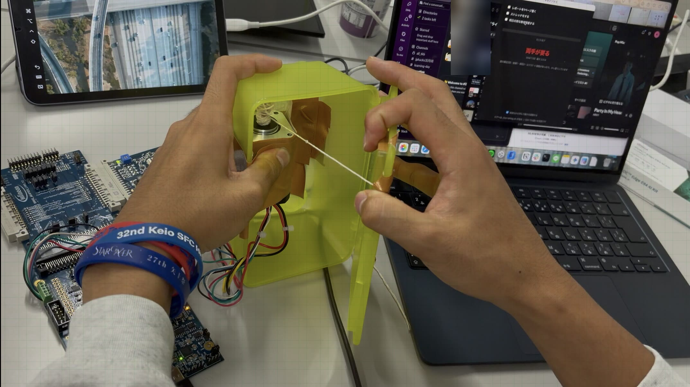

# オモイゾウコ

**やることが残っている夜ほど、冷蔵庫の扉が重くなる。**

ハードウェアの動きは、ぜひ動画でご覧ください（画像をクリックすると動画が開きます）。

[](https://youtu.be/DcB4BT7XZRE)

### 30秒でわかるオモイゾウコ

- **何をするか**：やることが残っているほど、冷蔵庫の扉が重くなる。ただし開かなくはならない
- **しくみ**：扉とモータを糸でつなぎ、開けようとする力にモータが逆らう。逆らう強さは FOC で段階的に変えられる
- **Hack Day で動いたもの**：タスクの達成度で扉の重さが変わる／手を合わせて「お願い」すると1回だけ軽くなる／開けたあとの気持ちで次の重さが変わる
- **まだできていないこと**：糸を使わない蝶番での駆動、磁気センサーによる開閉の検知

## 製品概要

### 背景（製品開発のきっかけ、課題等）

深夜、やるべきことが終わっていないのに冷蔵庫を開けて、つまみ食いをして、あとで後悔する。
誰にでも覚えがあるのではないでしょうか。

問題は「食べたこと」そのものではありません。**何も考えずにつまみ食いをして、あとで後悔してしまうこと**です。
だから、食べ物を取り上げても解決しません。食べられなかった夜に残るのは納得ではなく我慢で、
結局は別の誘惑に流れてしまいます。

一方で、アプリの通知は無視できます。画面を閉じればそれで終わりです。
やるべきことを思い出させる仕組みは世の中にたくさんありますが、
**本当に手が伸びるその瞬間に、無視できない形で届くもの**はありませんでした。

### 製品説明（具体的な製品の説明）

**その日の達成度が、冷蔵庫の扉の「重さ」になって返ってくる冷蔵庫です。**

やるべきことを終えていれば、扉はいつもどおり軽く開きます。
終えていなければ、開けるときにずっしりとした手応えがあります。

大事なのは、**扉が開かなくなることはない**という点です。オモイゾウコは食べることを禁止しません。
やるべきことが残っていても扉は開きます。ただ、重いだけです。
食べるかどうかを決めるのはあくまで本人で、機械は判断しません。

扉の重さは、その日のタスクで決まります。
タスクを登録すると、Claude API がそれぞれの「重さ（大変さ）」を推定し、まだ終わっていないタスクの重さの合計から扉の重さを決めます。
タスクを終えてチェックを入れるたびに、扉は少しずつ軽くなります。

どうしても今食べたいときは、冷蔵庫に「お願い」することもできます。
PSOC™ Edge E84 AI Kit に搭載された XENSIV™ 60GHz レーダー（BGT60TR13C）が、手を合わせて前に突き出す動きを読み取り、次の1回だけ扉を軽くします。
ただし、お願いを聞くのは3時間に1回までです。

試作機では、扉とブラシレス（BLDC）モータの軸を糸でつないでいます。
モータは扉を押さえつけるのではなく、**人が開けようとしたときにだけ、その力に逆らいます**。
FOC（ベクトル制御）でモータの電流を直接指令しているので、この「逆らう強さ」をソフトウェアから自由に変えられます。
電源が切れればモータの軸は自由に回り、扉はふつうに開きます。

### 特長

#### 1. 禁止せず、手応えで伝える

ロックのように「開く／開かない」の二択ではなく、達成度に応じて重さが段階的に変わります。
電流（＝トルク）を直接指令する FOC だからこそできることで、
サーボモータや電磁ロックでは「ほどほどの力で押し返す」ことができません。

#### 2. 通知と違って、無視できない

スマートフォンの通知は消せても、手に伝わる抵抗は消せません。
体で受け取るフィードバックは、画面上の表示よりも確実に届きます。

#### 3. モータが、動かす装置であると同時にセンサーにもなる

FOC では、モータに流れる電流から、ユーザーが加えた力を読み取れます。
ホールセンサーで測る軸の位置（1回転24カウント）と合わせれば、
**ロードセルや角度センサーを追加しなくても**、いつ・どれくらいの力で扉を開けたかを記録できます。

#### 4. 「どれだけ食べたかったか」を測り、そのあとの気持ちで重さを変える

扉を開けるたびに、手がモータに対してした仕事（ミリジュール）を記録します。
**食べたい気持ちの強さが、物理量として毎回残る**のです。画面をタップするだけのアプリでは取れないデータです。

扉を開け切ったあとは、画面に「食べてどうだった？（満足／ふつう／後悔）」と表示され、1タップで答えられます。
途中で手を止めた回は「我慢できた」として自動で記録されます。
この記録をもとに、最近後悔が多い時間帯は次から重く、満足が多い時間帯は軽くします。
一度決めた重さで終わりではなく、**その人の「後悔しやすいパターン」に合わせて重さが育っていく**点が、
通知アプリや単純なロックとの違いです。

### 解決できること

後悔そのものをなくせるわけではありません。

オモイゾウコがしているのは、**食べたあとの後悔を、食べる前のためらいに前倒しすること**です。
食べてしまったあとの後悔は取り返しがつきませんが、食べる前のためらいなら、まだ選び直せます。
後悔を「取り返しのつくもの」に変える、と言い換えてもいいかもしれません。

一方で、やるべきことが終わっていない夜には、かえって罪悪感が強くなるおそれもあります。
何かを伝える道具は、悪い知らせも伝えてしまうからです。
今回はこの課題を解決しきれませんでしたが、設計を考えるうえで大事な論点だと考えています。

### 今後の展望

- **蝶番（ヒンジ）から直接動かし、糸をなくす**
  試作機では扉とモータを糸でつないでいるため、糸が見えてしまいます。実際の冷蔵庫で糸を使うのは現実的ではありません。
  モータを扉の蝶番の軸に取り付け、**減速ギアを介して蝶番から直接トルクをかける**ことで、
  糸のない、見た目にも自然な構造にできます。モータ単体のトルク（定格 0.125 N·m）では冷蔵庫の扉に逆らうには足りないため、
  ギアで増幅します。蝶番に取り付ける場合の制御設定（[`host/mounts/hinge.json`](host/mounts/hinge.json)）は、用意してありますが、実機ではまだ試していません。
- **磁気センサーで扉の開け閉めを検知し、安全性を高める**
  モータに分かるのは糸と軸の動きだけなので、扉が「閉まった」のか「開いたまま止まっている」のかを区別できません。
  そのため試作機では、開けたまま手を離したふたが、糸の巻き戻しで閉まってしまうことがあります。
  扉に磁石、本体に XENSIV™ 3D 磁気センサーを取り付けて開け閉めを直接検知すれば、閉まったときだけ糸を巻き戻せるようになり、
  扉に指を挟むといった危険も防げます（ハッカソン中にセンサーと磁石の取り付けまでは行いましたが、センサーとの通信が間に合いませんでした）。
- 既存のタスク管理ツール（Google カレンダー、Todoist など）との連携
- PSOC™ Edge E84 AI Kit のカメラを使った達成判定の自動化（現状は自己申告なので、申告の信頼性を高めたい）
- 開け閉めの記録の蓄積と可視化。開ける前に「今週4回目です」と見せる
- 気持ちの記録を数週間分ためて、後悔の割合・我慢できた回数・引いた力がどう変わったかを分析する。
  今の「時間帯ごとの単純なルール」を、本人のデータから学習するモデルに置き換える
- E84 のレーダーで「冷蔵庫の前まで来たけれど開けなかった」も数え、我慢の記録をより正確にする
- 冷蔵庫以外の誘惑（ゲーム機の収納、引き出しなど）への応用

### 注力したこと（こだわり等）

* **限られたハードウェアの中で、Infineon 様にご提供いただいた機材を存分に活用したこと。**
  モータ制御キット（PSOC™ Control C3）で力を測って押し返し、PSOC™ Edge E84 AI Kit のレーダーと AI 専用演算器で手の動きを判定するなど、
  「感じる・考える・返す」をすべて Infineon の製品でつないでいます（詳しくは「開発技術」をご覧ください）。
* **「開かなくする」を選ばなかったこと。** ロックや罰として作るほうが実装は簡単で、デモも派手になります。
  しかし、抜け道があれば一瞬で崩れますし、何より使う本人の味方になりません。
  禁止せずに伝えるという、一番難しい道を選びました。
* **停電や故障で扉が開かなくならないこと。** 電源が切れるとモータの軸は自由に回るので、扉はふつうの扉に戻ります。
  中に人や物が閉じ込められる作りにはしていません。PC からの信号（ハートビート）が途切れたときも、モータへの電流を切ります。
* **「このキットでなければ作れないのか」を最後まで問い続けたこと。**
  開く・開かないの二択ならサーボモータで十分です。重さを段階的に変える設計にしたのは、
  FOC でなければ実現できない価値を示すためでもあります。

## 開発技術

### Infineon の技術で「感じて・考えて・返す」をひとつにつなぐ

センサー・判断・アクチュエータのすべてを、Infineon のマイコンとセンサーでつないでいます。
マイコンは2つ使い、役割を分けています。

| | 使った Infineon の製品・ツール | この作品での役割 |
|---|---|---|
| **感じる（Sense）** | PSOC™ Control C3（PSC3M5）の電流センシングと、モータ内蔵ホールセンサーの読み取り（TCPWM / MOTIF） | 扉を開ける力と距離を、**ロードセルや角度センサーを足さずに**測る。1回ごとに「どれだけの力で開けたか」をミリジュールで残す |
| | XENSIV™ 60GHz レーダー BGT60TR13C（PSOC™ Edge E84 AI Kit に搭載） | 手を合わせて「お願い」する動きを、カメラを使わずに感じ取る |
| **考える（Think）** | PSOC™ Edge E84 の Arm® Cortex®-M55 と AI 専用演算器 Ethos™-U55、DEEPCRAFT™ Studio のモデル | レーダーの波形から手の動きを、クラウドに送らずボードの中で判定する |
| | PSOC™ Control C3 の Arm® Cortex®-M33（FPU） | 開けた距離と速さから、ばね・粘り・粘り負けの強さを1ミリ秒ごとに決める状態機械 |
| **返す（Act）** | PSOC™ Control C3 の FOC（ModusToolbox™ motor-ctrl-lib）と、Infineon のモータ駆動パワーボード KITMOTORDC250W24V | 電流＝トルクを直接指令して、「ほどほどの力で押し返す」手応えをつくる |
| **開発環境** | ModusToolbox™（2つのボードのファームウェア）、KitProg3（E84 への書き込みとシリアル通信） | |

* 1台のモータキットが、アクチュエータであると同時に力のセンサーにもなっています。
  「開ける力を測る」と「押し返す」を同じ部品でこなせるのは、電流を直接扱う FOC だからです。
* AI による判定は E84 の中で完結し、レーダーなのでカメラの映像も残りません。冷蔵庫のように家の中に置くものに向いています。

### 活用した技術

#### API・データ

* J-Link SWD によるマイコンのメモリの直接読み書き（PyLink）
  ファームウェアの `door` 構造体を PC から読み書きし、マイコンを動かしたまま指令と計測値をやり取りします。
  Infineon の Motor Suite GUI と同じ方式です。
* KitProg3 の USB シリアル（pyserial）
  E84 がレーダーで判定した手の動きのスコアを受け取ります。
* Anthropic Claude API（`claude-haiku-5-5`）
  タスクの重みを推定します。呼び出すのはタスクを追加・推定するときだけで、制御ループからは呼びません。

#### フレームワーク・ライブラリ・モジュール

* ModusToolbox™（マイコン側、C 言語）。モータ制御には motor-ctrl-lib（FOC、ホールセンサーによる位置検出）を使用
* DEEPCRAFT™ Studio で作られたレーダージェスチャーのモデル（Infineon のコード例をそのまま使用）
* PyLink / pyserial / Tkinter（PC 側、Python）

#### デバイス

* Infineon KIT_PSC3M5_MC1（PSOC™ Control C3M5 Complete System Motor Control Kit）
  * 制御ボード KIT_PSC3M5_CC2。マイコン：PSC3M5FDS2AFQ1 / Arm® Cortex®-M33、最大 180MHz
  * DSP・FPU・CORDIC のハードウェアアクセラレータ
  * TCPWM と MOTIF（Motion Interface）ブロック
  * オンボードデバッガ SEGGER J-Link LITE
  * パワーボード KITMOTORDC250W24VTOBO1、24V/1A の AC アダプタ
* Nanotec DB42M03 24V ブラシレスモータ（42mm 角、8極、定格 3.47A、トルク定数 0.036 N·m/A）
* ホールセンサー（モータ内蔵、回転子の位置を検出。1回転 24カウント＝15°ごと）
* Infineon KIT_PSE84_AI（PSOC™ Edge E84 AI Kit）
  * マイコン：PSE846GPS2DBZC4A / Arm® Cortex®-M55 ＋ Ethos™-U55（AI 専用演算器）
  * XENSIV™ 60GHz レーダー BGT60TR13C

### 独自技術

#### ハッカソンで開発した独自機能・技術

* **扉の抵抗を制御するファームウェア** — [`motor-fw/door.c`](motor-fw/door.c) / [`motor-fw/door.h`](motor-fw/door.h)
  （commit `854a168`, `50266e7`, `b72a754`, `8446267`, `105256c`, `3e13402`, `a9ecea7`, `42d5c6a`）
  モータで「回す」のではなく「回されることに抵抗する」ために、ホールセンサーの位置から扉が開く向きの動きを検出し、
  `level` に応じた電流を逆向きに流します。DISARMED / IDLE / RESIST / COOLDOWN の状態機械で、
  糸のたるみ取り、回りすぎ、長時間の抵抗による発熱を管理しています。
  * **手応えの形**：開けた距離に応じて強くなるばね、開ける速さに応じた粘り、開け始めの「ブルッ」という警告の振動
  * **人間らしく粘り負けする**：強い力で1秒耐えたあと、4秒かけて力が抜け、最後は 0 になる。扉は必ず最後には開く
  * **開けた記録**：1回開けるごとに、手がモータに対してした仕事（mJ）・最大電流・距離・時間・途中でやめたかを記録する
    （電流 × トルク定数 × 回転角から計算）
  * **閉じた位置まで糸を巻き戻す**：一番巻き取った位置を「閉じた位置」として覚え、扉を閉めたあとに軸がその手前で止まったら、
    短く強めに引いて巻き取りを再開させる。引いても近づかなければ（手で押さえている・開いたまま）3回でやめて待つので、
    扉を無理に閉めない

* **PC とファームウェアをつなぐライブリンク** — [`host/door_link.py`](host/door_link.py)
  ELF ファイルからシンボルのアドレスを調べ、J-Link 経由で `door` 構造体を直接読み書きします。
  UART を使わず、マイコンを動かしたまま指令と計測値を扱えます。
  PC が信号（ハートビート）を送り続けないとモータの電流が切れる、ウォッチドッグの仕組みも実装しました。
  電源や USB が抜けても自動でつなぎ直します。手応えの設定は取り付け方ごとに [`host/mounts/*.json`](host/mounts) にまとめ、
  `control.json` に書けば動作中でも変えられます。

* **手を合わせて「お願い」する** — [`edge-fw/`](edge-fw) / [`host/gesture.py`](host/gesture.py)（commit `97ffaca`）
  E84 のレーダーと AI 専用演算器で手の動きを判定し、手を合わせて前に突き出す（Push）と、次の1回だけ扉が軽くなります。
  お願いを聞くのは3時間に1回までです。カメラを使わないので、家の中でもプライバシーの心配が少なくて済みます。

* **タスクの重み付け** — [`host/fridge.py`](host/fridge.py)（commit `3869d92`, `92eeb79`）
  タスクの「重さ」を Claude が推定し、未完了のタスクの重みの合計から扉の重さを決めます。

* **開けたあとの気持ちで、次の重さを変える** — [`host/reflect.py`](host/reflect.py) / [`host/fridge_gui.py`](host/fridge_gui.py)
  開け切るたびに「満足／ふつう／後悔」を1タップで記録し、その回の引いた力・時刻・残りのタスクと一緒に保存します。
  時間帯（昼／夜）ごとに最近5回の答えを見て、最大の力を 0.75〜1.25 倍に調整します（上限 2.5A）。
  調整の理由を画面に表示できるよう、あえて単純なルールにしています。段階（level）の決まり方は変えないので、
  寸劇の流れは崩れません。動きを固定したいときは、画面のチェックで学習を止められます。

* **ブラウザで動くシミュレーター** — [`host/sim/`](host/sim)（commit `01d7657`）
  ファームウェアの制御を JavaScript に移し、扉と手の物理モデルと組み合わせて、実機がなくても手応えの設定を試せるようにしました。
    リポジトリをダウンロードして [`host/sim/index.html`](host/sim/index.html) をブラウザで開くと、画面上の扉をマウスでドラッグして手応えを試せます。
  （`host/sim/serve.sh` で起動して http://127.0.0.1:8791/sim/ を開くと、実機と同じ `host/mounts/*.json` の設定を読み込みます）

* **センサーレスではなく、ホールセンサーによる位置検出を選んだこと**（commit `50266e7`）
  扉を開ける動作はほぼ止まった状態から始まるため、センサーレスの FOC では回転子の位置を推定できず、
  止まったまま力を出すことができません。SysTick 割り込みでホールセンサーを読む構成にして解決しました。

* **止まったまま力を出すと誤って停止する問題を回避**（commit `b72a754`）
  扉を押さえて止まっている間は、電流が流れていても軸が回りません。そのためライブラリが「相が外れた」と誤って判断し、
  モータを止めていました。この検知を外し、それ以外の異常は2秒ごとに自動で解除して復帰するようにしました。

## ハードウェアと動かし方

### 全体の構成

```
[扉] ──糸── モータ軸（DB42M03）
                │ 動力線3本 ＋ ホールセンサー5本
[パワーボード KITMOTORDC250W24V] ── 24V AC アダプタ
                │ アダプタボード
[制御ボード KIT_PSC3M5_CC2]  motor-fw/door.c が電流を決める
                │ USB-C（J-Link）
[Mac]  run-string.sh（door_link.py） ← control.json ← fridge_gui.py ← tasks.json / weights.json
                │ USB-C（KitProg3 のシリアル）
[PSOC Edge E84 AI Kit]  edge-fw：レーダーで手の動きを判定
```

### 配線（作業は必ず 24V を抜いてから）

| 場所 | つなぎ方 |
|---|---|
| 制御ボードのジャンパ X20 | 2-3 側（V5V）。制御ボードの電源をパワーボードから取る |
| 制御ボードの DIP スイッチ SW3 | すべて右側 |
| モータの太い線（動力線） | パワーボードのネジ端子 CN3：黄 → U、赤 → V、黒 → W |
| モータの細い線（ホールセンサー） | 制御ボードの X3：赤 +5V → 1、青 H1 → 2、白 H2 → 3、緑 H3 → 4、黒 GND → 5 |
| 24V AC アダプタ | パワーボードの CN1（丸い DC ジャック） |
| Mac | 制御ボードの USB-C（X10）。E84 は KitProg3 側の USB-C（J1） |

* 太い線にも細い線にも赤と黒があります。取り違えると、ボードやモータを壊すおそれがあります。
* USB からの電源は J-Link にしか届きません。マイコンは 24V 側で動いているので、24V を抜くとボードは止まります。

### 機構（糸の取り付け）

* 糸はモータの軸に直接巻き付け、先端を扉の取っ手側に結んでいます。糸巻きは使っていません。
* 軸が1カウント（15°）回ると、糸が約2mm出ます（巻いた太さで変わります）。
* 取っ手にかかる力は、2A のときで約10Nです（太めの糸の場合）。
* 軸に横からかけてよい力は、付け根から20mmの位置で最大28Nです。糸はなるべく軸の付け根近くに巻いてください。
* 扉が閉まっている間は 0.15A で糸を巻き取り、たるまないようにしています（0.2A では糸がきつすぎました）。
  ただし、止まった軸はこの電流では回り出さないことがあるため、閉じた位置の手前で**2秒**止まっていたら、
  0.6A で0.2秒だけ引いて回し始めます。効かなければ3回でやめて5秒待ち、それを3回くり返しても近づかなければ、
  その位置を新しい閉じた位置とみなします。待ち時間は `windwait`（ミリ秒）で変えられます。
* 試作機のふたは軽いため、開けたまま手を離すと、この巻き戻しで閉まります（「今後の展望」の磁気センサーで解決する予定です）。
* 閉じた位置は電源を入れるたびに覚え直します。**`run-string.sh` を起動するときや 24V を挿すときは、扉を閉めて糸を張っておいて**ください。

### デモの動かし方

Mac では窓を2つ使います。**必ず 1 → 2 の順に起動**してください。`run-string.sh` は、自分が起動する前に書かれた `control.json` を無視します。

```sh
cd host
./run-string.sh                                      # 窓1：ボードにつないで、手応えの設定を送る
uv run --python 3.11 --with pyserial fridge_gui.py   # 窓2：タスクの画面。チェックすると扉の重さが変わる
```

* `run-string.sh` は `host/.venv`（Python 3.9、pylink-square と pyserial）で動きます。
  作り直すときは `uv venv host/.venv && uv pip install --python host/.venv/bin/python pylink-square pyserial` を実行します。
* GUI は Python 3.11（uv が入れるもの、Tk 8.6）で動かします。macOS 付属の Python 3.9（Tk 8.5）では、文字や色が表示されません。
* `weights.json`（タスクの重み）があると、重みの合計で段階が決まります。今の重み（レポート 0.9 / ストレッチ 0.2 / 持ち物 0.4）では、
  寸劇は**ストレッチ → 持ち物 → レポートの順にチェック**します。level は 1.00 → 1.00 → 0.50 → 0.00 と変わります。
  レポートを最初にチェックすると、いきなり 0.25 まで下がります。
* E84 がつながっていれば、GUI はレーダーで「お願い」を見張ります。
  E84 の表側（Infineon のロゴがある面）の正面、約60cm の位置から、手を合わせて20〜30cm 前に突き出すと、
  画面が「今回だけだよ」に変わり、次に1回開け切るまで扉が軽くなります（30秒で元に戻ります）。判定の様子は窓2に流れます。
* お願いを聞くのは **3時間に1回まで**です。それより早いお願いには「お願いは3時間に1回まで（あと○時間○分）」と表示され、
  重さは変わりません。GUI を起動し直しても数え続けます（`host/logs/onegai.json`）。
  誤作動やリハーサルで使ってしまったときは、**本番の前に GUI の画面で Ctrl+R（⌘R でも可）** を押すとリセットできます。
* 開け切ると、画面に「食べてどうだった？」と3つのボタンが出ます（60秒で消えます）。
  答えは `host/logs/feelings.csv` に保存され、`python3 reflect.py` で日ごとの表にできます。
  別の CSV を渡せば（`python3 reflect.py sample.csv`）、同じ形式の表を出せます。
  学習によって最大の力が変わると、画面の「最大 ○ A」とその理由の表示も変わります。

### 手応えの設定（`host/mounts/string.json`）

| 項目 | 今の値 | 意味 |
|---|---|---|
| `take` | 0.15 A | 閉まっている間の巻き取り電流 |
| `max` | 2.0 A | level 1.0 のときの最大電流 |
| `free` / `ramp` | 0 / 12 カウント | 引き始めから重くなり始め、約2.5cm で最大になる |
| `damp` | 0.005 A/(カウント/秒) | 開ける速さに応じた粘り |
| `full` | 36 カウント | 約7.5cm 開けたら「開け切った」と記録する |
| `buzzamp` / `buzzhz` / `buzzms` | 0.6 A / 40 Hz / 200 ms | 開け始めの「ブルッ」。level が 0.5 以上のときだけ鳴る（`buzzlevel`） |
| `relentdelay` / `relent` / `floor` | 1秒 / 4秒 / 0 | 最大の力で1秒耐えたあと、4秒かけて 0 まで力を抜く |
| `recover` | 1.5秒 | 手を離したあと、元の強さに戻るまでの時間 |
| `release` | 3 カウント | 扉がこれだけ戻ったら「手を離した」とみなす |
| `windwait` | 2000 ms | 閉じた位置の手前でこれだけ止まっていたら、強めに引いて巻き戻す |

`level`（0〜1）は GUI が決めます。タスクの状態に応じて 0 / 0.25 / 0.5 / 1.0 の4段階になります。
設定は動作中でも変えられます。窓1に `ramp 20` のように入力するか（日本語入力中は Enter を2回）、
`control.json` に `{"ramp": 20}` のように書いてください。

### 安全のしくみ

* 電流の上限は 3A（モータの定格 3.47A 未満）です。電流は糸を巻き取る向きにしか流さないので、糸が扉を押すことはありません。
* Mac からのハートビートが 0.5秒途切れると、モータへの電流を切ります（Mac が止まっても、扉はふつうの扉に戻ります）。
* 抵抗を10秒続けたら、3秒休みます（発熱対策）。
* 巻き取りが毎秒400カウント（どちら向きでも毎秒1500カウント）を超えたら、速さが落ち着くまで電流を切ります。
  糸が切れたりたるんだりしたときや、手を離したときに、糸を勢いよく巻き込まないためです。
* 「ブルッ」の振動は 1A / 100Hz / 1秒が上限です。
* 電源が切れると軸は自由に回り、扉はふつうに開きます。

### ファームウェアの書き込み

```sh
cd motor-fw
make build
./flash.sh   # make program は "No PCode loaded" で失敗することがあるため、こちらを使う
```

* 書き込む前に `run-string.sh` を止めてください。J-Link は同時に1つのプログラムからしか使えません。
* `run-string.sh` と `flash.sh` は、モータキットの J-Link を**シリアル番号で選びます**（このチームのキットは 591234791）。
  磁気センサーのキットにも同じ名前の J-Link が載っていて、両方つながっていると取り違えるためです。
  別のキットを使うときは、環境変数 `DOOR_JLINK_SERIAL` に番号を指定してください（空にすると、つながっている J-Link を使います）。
* 今ボードに書き込んであるのは、閉じた位置まで巻き戻す機能と、その前の待ち時間（`windwait`）を加えた版（commit `42d5c6a`）です。

### E84（「お願い」のレーダー）

```sh
cd edge-fw
make getlibs    # 初回だけ。ライブラリ（mtb_shared）はリポジトリに含めていない
make build
make program    # KitProg3 側の USB で書き込む
```

* 中身は Infineon のコード例 `mtb-example-psoc-edge-ml-deepcraft-deploy-radar` です。
  レーダーの受信波形（5ミリ秒ごとに128個の数値）を、そのまま AI のモデルに入力しています。
* `cd host && .venv/bin/python gesture.py watch` で、Push のスコアだけを確認できます（GUI と同時には使えません）。
* 判定には約0.5〜1.2秒の遅れがあります。
* **限界**：形ではなく「何かが近づいて戻った」という動きを見ているため、人が動き回る場所では誤作動が多くなります。
  Circle は誰もいなくてもスコアが高く出るので、使っていません。
